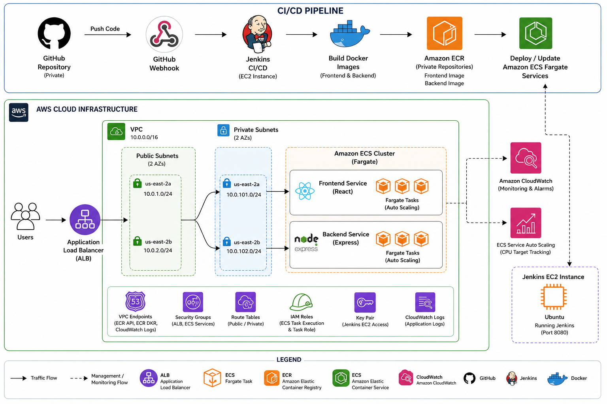
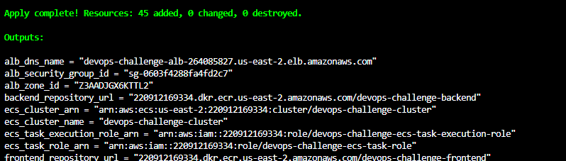
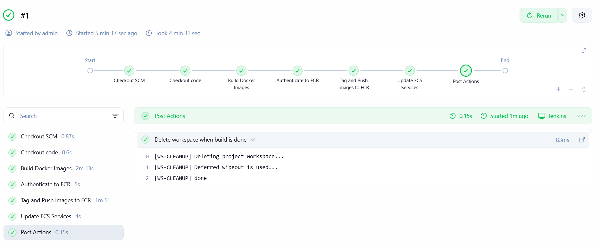
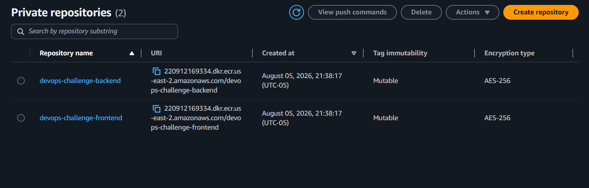
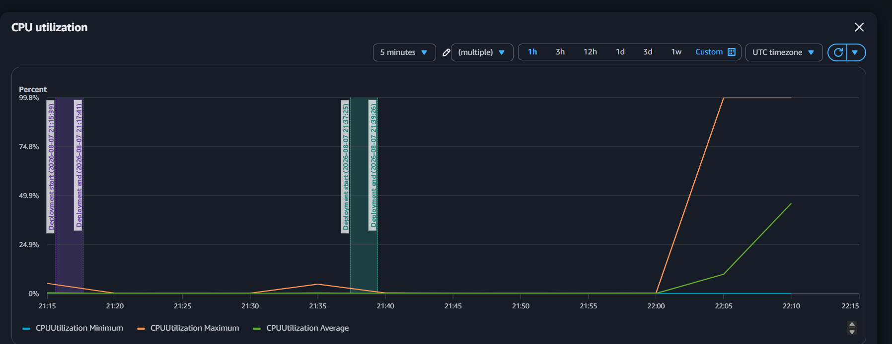
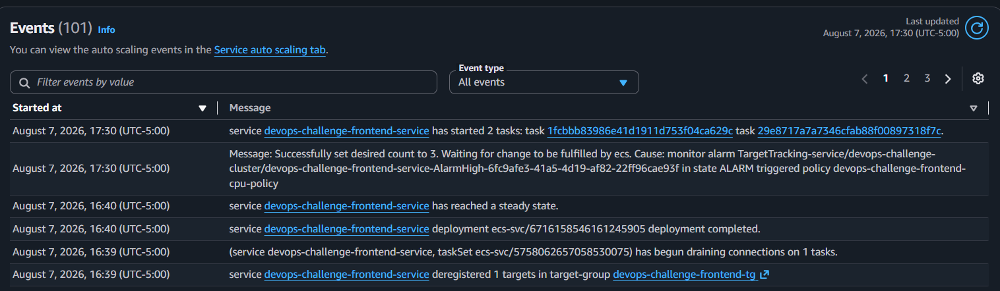

# AWS ECS Fargate | Infrastructure Automation & CI/CD Platform

## Project Overview

This project demonstrates an end-to-end DevOps CI/CD pipeline deployed on AWS. The application consists of a React frontend and an Express backend, both containerized with Docker and deployed to Amazon ECS Fargate using Terraform. A Jenkins pipeline automates the build, image publishing, and deployment process, while ECS Service Auto Scaling automatically adjusts capacity based on application load.

## Architecture

The following diagram illustrates the complete CI/CD workflow and AWS infrastructure used for this project.



### Deployment Flow

```text
GitHub Repository
        ↓
GitHub Webhook
        ↓
Jenkins CI/CD Pipeline
        ↓
Docker Image Build
        ↓
Amazon ECR
        ↓
Amazon ECS Fargate
        ↓
Application Load Balancer
        ↓
React Frontend ↔ Express Backend
```

---

## Technologies Used

- Terraform
- Docker
- Jenkins
- GitHub
- Amazon ECS Fargate
- Amazon ECR
- Application Load Balancer (ALB)
- Amazon CloudWatch
- ECS Service Auto Scaling
- React
- Express.js

---

## Infrastructure as Code

Terraform was used to provision the AWS infrastructure, including:

- VPC
- Public and Private Subnets
- Security Groups
- Application Load Balancer
- Amazon ECS Cluster
- ECS Services
- Amazon ECR Repositories
- IAM Roles
- Jenkins EC2 Instance
- ECS Service Auto Scaling

### Deploy Infrastructure

```bash
terraform init
terraform plan
terraform apply
```

Terraform successfully provisioned all required AWS infrastructure.



---

## CI/CD Pipeline

Jenkins automates the deployment process by performing the following stages:

1. Checkout source code from GitHub
2. Build frontend Docker image
3. Build backend Docker image
4. Authenticate with Amazon ECR
5. Push Docker images to Amazon ECR
6. Update Amazon ECS services
7. Clean the Jenkins workspace



---

## Amazon Elastic Container Registry (ECR)

The Jenkins pipeline builds and publishes both the frontend and backend Docker images to private Amazon ECR repositories before deploying them to ECS.



---

## ECS Service Auto Scaling

ECS Service Auto Scaling was configured using a Target Tracking policy based on average CPU utilization.

### Configuration

- Minimum Tasks: **1**
- Maximum Tasks: **4**
- Scaling Metric: **Average CPU Utilization**
- Target Tracking Policy

To validate Auto Scaling, ApacheBench was used to generate application load.

### Load Test

```bash
ab -n 100000 -c 250 http://<ALB-DNS>/
```

### Results

During the load test:

- CPU utilization increased under sustained traffic.
- CloudWatch monitoring detected the increase in utilization.
- ECS Service Auto Scaling automatically increased the desired task count.
- Additional Fargate tasks were launched and registered with the Application Load Balancer.

### CloudWatch Metrics



### Auto Scaling Event



---

## Application URLs

### Frontend

```
http://devops-challenge-alb-264085827.us-east-2.elb.amazonaws.com
```

### Jenkins

```
http://3.19.128.40:8080
```

---

## Lessons Learned

This project provided hands-on experience with:

- Building cloud infrastructure using Terraform
- Implementing Infrastructure as Code (IaC)
- Containerizing applications with Docker
- Creating CI/CD pipelines with Jenkins
- Publishing Docker images to Amazon ECR
- Deploying containerized applications to Amazon ECS Fargate
- Configuring Application Load Balancer routing
- Implementing ECS Service Auto Scaling
- Monitoring application performance with Amazon CloudWatch
- Troubleshooting ALB listener rules and ECS Auto Scaling behavior
